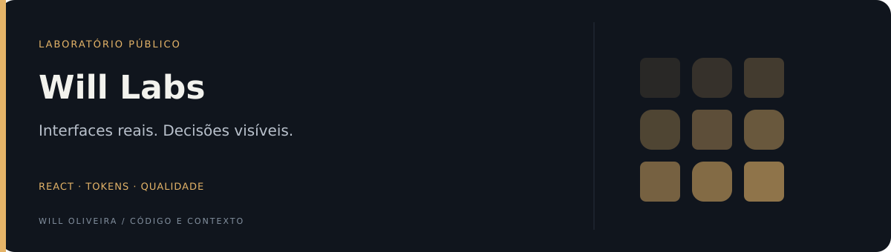
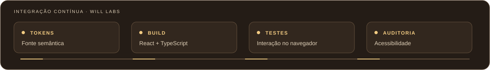

<p align="center">
  
</p>

<div align="center">

# Will Labs

**Design system em React e TypeScript, base de um laboratório público de engenharia.**

[](https://github.com/Will-Ifes/will-labs/actions/workflows/ci.yml) [](https://github.com/Will-Ifes/will-labs/actions/workflows/pages.yml)

[**Ver catálogo**](https://will-ifes.github.io/will-labs/) &nbsp;·&nbsp; [Componentes](packages/ui-react) &nbsp;·&nbsp; [Padrões](docs/padroes/README.md) &nbsp;·&nbsp; [Roadmap](docs/plano/roadmap.md) &nbsp;·&nbsp; [Decisões](docs/adr)

</div>

<a href="https://github.com/Will-Ifes/will-labs/actions/workflows/ci.yml">
  
</a>
<p align="center"><sub>Etapas configuradas no CI. O resultado real de cada execução é o badge acima.</sub></p>

## Explore o diferencial

**[Estudo de caso: do guia visual ao componente React](https://will-ifes.github.io/will-labs/#estudo-de-caso)** · [Versão com referências no repositório](docs/case-study.md)

| Ponto de entrada | O que observar |
| --- | --- |
| [Do contrato ao componente](packages/ui-react) | O pacote React permite seguir a implementação além da demonstração. |
| [Evidência de navegador](evidence/VIEW-AUDIT.md) | A auditoria registra verificações e limites da avaliação por view. |

## Em números

|        40         |           8            |           61            |              0              |
| :---------------: | :--------------------: | :---------------------: | :-------------------------: |
| componentes React | temas (claro e escuro) | views auditadas com axe | violações detectadas pelo axe |

<sub>Medido em 13/10/2026. Fontes: exports de `@will-labs/ui-react`, `themes.json` e [`evidence/VIEW-AUDIT.md`](evidence/VIEW-AUDIT.md).</sub>

A avaliação automática cobre os cenários registrados e não substitui testes manuais com tecnologias assistivas.

## O que o CI verifica

|     | Etapa                                                                    | Reprova quando                                                          |
| :-: | ------------------------------------------------------------------------ | ----------------------------------------------------------------------- |
|  ✓  | **Formato** (Prettier)                                                   | um arquivo sai do padrão                                                |
|  ✓  | **Lint** (oxlint)                                                        | qualquer erro ou aviso das regras dos [padrões](docs/padroes/README.md) |
|  ✓  | **Tipos** (TypeScript estrito, [tsconfig.base.json](tsconfig.base.json)) | há erro de tipo                                                         |
|  ✓  | **Commits** (commitlint)                                                 | a mensagem foge de `tipo(escopo): resumo`                               |
|  ✓  | **Interação** (Playwright)                                               | teclado, foco ou estado falha em 1440 ou 390 px, nos 8 temas            |
|  ✓  | **Acessibilidade** (axe)                                                 | axe identifica uma violação nos cenários auditados                                                 |
|  ✓  | **Firefox e WebKit** (smoke test)                                        | Dropdown, Select ou carregamento falham nesses motores                  |

## O que ainda não é medido

|     | Lacuna                            | Situação                                                                           |
| :-: | --------------------------------- | ---------------------------------------------------------------------------------- |
|  ·  | Testes unitários e cobertura      | Previsto na Sprint 5                                                               |
|  ·  | Comparação visual automática      | Capturas geradas, sem comparação                                                   |
|  ·  | Leitor de tela                    | [Roteiro manual](docs/plano/roteiro-leitor-de-tela.md) pronto, ainda não executado |
|  ·  | Firefox e WebKit                  | Só smoke test (Dropdown, Select, carregamento); a suíte completa roda em Chromium  |
|  ·  | Desempenho (Web Vitals)           | Previsto na Sprint 12                                                              |
|  ·  | Limite de bundle e de tempo de CI | Registrados, sem limite: 113 kB gzip, ~6 min                                       |

## Onde o projeto está

| Sprint            |      | Entrega                                                                            |
| ----------------- | :--: | ---------------------------------------------------------------------------------- |
| 0 · Fundação      | ●●●● | Repositório, licença MIT, ADRs, lint, commits e hooks locais                       |
| 1 · Design system | ●●●○ | Tokens, componentes e catálogo público. Falta executar o roteiro de leitor de tela |
| 2 · WilFlowLab v0.1 | ○○○○ | API, banco e telas do produto                                                      |
| 3 · Lançamento    | ○○○○ | Trilha e Labs 01 e 02                                                              |

<sub>Plano completo: 17 sprints e 16 Labs. "Fluxos" no catálogo é uma demonstração sem backend.</sub>

## Começar

```sh
npm ci && npm run build && npm start
```

Abra [localhost:4174/react/](http://localhost:4174/react/). Requer Node.js 22.12+.

<details>
<summary><strong>Validar localmente</strong></summary>

<br>

```sh
npm run format:check
npm run lint
npm run typecheck:react
npm test            # com npm start em outro terminal
npm run test:audit
```

Os testes usam Chromium (`npx playwright install chromium`) ou um Chrome indicado em `CHROME_PATH`.

</details>

<details>
<summary><strong>Estrutura do repositório</strong></summary>

<br>

| Caminho             | Conteúdo                                           |
| ------------------- | -------------------------------------------------- |
| `packages/tokens`   | Fonte única dos 8 temas                            |
| `packages/ui-react` | Componentes React                                  |
| `packages/ui`       | CSS compartilhado com o guia original, em migração |
| `apps/site`         | Catálogo publicado no Pages                        |
| `apps/docs`         | Guia original, preservado como referência          |
| `docs/padroes`      | Padrões de engenharia                              |
| `docs/adr`          | Decisões de arquitetura                            |
| `tests`, `evidence` | Testes de navegador e evidências                   |

</details>

<details>
<summary><strong>Usar em outra aplicação React</strong></summary>

<br>

```tsx
import "@will-labs/tokens/semantic.css";
import "@will-labs/ui/styles.css";
import "@will-labs/ui-react/styles.css";
import { Button, TextField } from "@will-labs/ui-react";
```

Pacotes na versão local 1.0.0, ainda não publicados no npm.

</details>

<br>

<div align="center">

**Will Oliveira** · [LinkedIn](https://www.linkedin.com/in/wildemberg-de-jesus-oliveira/) · [GitHub](https://github.com/Will-Ifes)

<sub>Contribuições seguem os [padrões](docs/padroes/README.md) e o [CONTRIBUTING](CONTRIBUTING.md).</sub>

</div>
