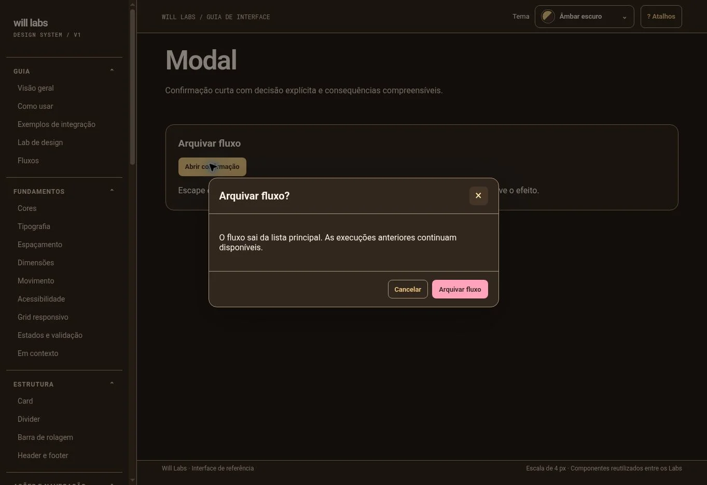
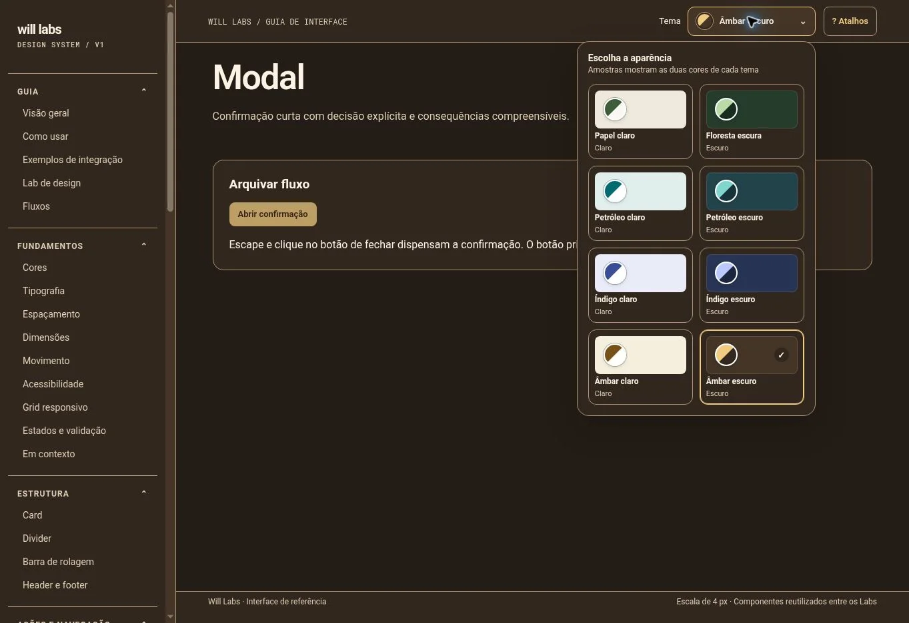

# Will Labs: do guia visual ao componente React

**Will Oliveira · projeto pessoal · estudo de caso publicado em 14/10/2026**

[Ler no site](https://will-ifes.github.io/will-labs/#estudo-de-caso) · [Experimentar o modal](https://will-ifes.github.io/will-labs/#comp-modal) · [Catálogo](https://will-ifes.github.io/will-labs/)

## O problema

Criei o Will Labs para reunir componentes, decisões de engenharia e demonstrações em uma aplicação pública. O guia HTML original já tinha uma identidade definida. A migração para React exigiu preservar essa referência e transformar os exemplos em peças reutilizáveis, com contratos, estados e comportamento verificável.

Este caso apresenta o design system e o catálogo. A API, o produto WilFlowLab e os Labs futuros pertencem ao roadmap. A demonstração de Fluxos ainda não tem backend.

## O recorte disponível

| Evidência          | Estado registrado                                                     |
| ------------------ | --------------------------------------------------------------------- |
| Componentes React  | 40 exports no recorte de 13/10/2026                                   |
| Temas              | 8, definidos em `packages/tokens/themes.json`                         |
| Auditoria de views | 61 views, com zero violações automáticas do axe no conjunto executado |
| Publicação         | Catálogo estático no GitHub Pages                                     |

Esses números descrevem a base documentada. Não são métricas de adoção por clientes, ganho de produtividade ou certificação de acessibilidade.

## Decisões e compromissos

### Tokens, componentes e catálogo em camadas diferentes

As cores e os temas ficam em [`packages/tokens`](../packages/tokens). Os componentes React vivem em [`packages/ui-react`](../packages/ui-react), e [`apps/site`](../apps/site) os consome. O pacote de UI não recebe os dados do futuro produto.

Essa separação permite discutir uma mudança de identidade na origem dos tokens e verificar o efeito nos consumidores. A migração ainda utiliza parte do CSS compartilhado de `packages/ui`; retirar essa dependência exige trabalho adicional.

### Preservar a referência visual durante a migração

O guia original continua disponível em `apps/docs`. Preservá-lo mantém um ponto de comparação para cores, proporções, conteúdo e estados. A [ADR-004](adr/ADR-004-design-system.md) registra a decisão inicial por um pacote próprio e a responsabilidade de manter teclado, foco e contraste. A ADR retrata a etapa inicial; o estado mais recente das views está na [auditoria](../evidence/VIEW-AUDIT.md).

### Usar a plataforma nativa como base

No modal, adotei o elemento `dialog`, com estado controlado pelo consumidor React. A escolha fornece a base de modalidade do navegador e mantém explícita a responsabilidade pela ação, pelo fechamento e pela retomada da tarefa.

## Um desafio concreto: fechar e retomar a tarefa

Uma confirmação precisa explicar a consequência da ação e permitir que a pessoa cancele e continue de onde estava. O cuidado na migração foi manter esse fluxo também por teclado e em telas pequenas.

A implementação em [`overlays.tsx`](../packages/ui-react/src/overlays.tsx):

- abre o diálogo com `showModal()` quando o estado muda;
- associa o título por `aria-labelledby`;
- trata o evento `cancel` para solicitar o fechamento;
- recebe `triggerRef` e devolve o foco ao controle que iniciou a ação.

As capturas mostram o estado aberto. A evidência do fechamento e do retorno de foco está no teste: [`tests/react-advanced.mjs`](../tests/react-advanced.mjs) abre o modal, pressiona Esc, verifica que o diálogo desapareceu e confere o controle ativo. O cenário percorre duas larguras e oito temas.

## Validação e limites

A [auditoria registrada](../evidence/VIEW-AUDIT.md) informa 61 views avaliadas com axe em desktop claro e mobile escuro, com zero violações automáticas no conjunto executado. Os testes de interação verificam cenários específicos; as [execuções do CI](https://github.com/Will-Ifes/will-labs/actions/workflows/ci.yml) mostram o resultado real de cada versão.

Há limites que permanecem importantes:

- o roteiro manual de leitor de tela ainda está pendente;
- Firefox e WebKit têm verificações de smoke, e não a mesma cobertura da suíte Chromium;
- as capturas ainda não têm comparação visual automática;
- a [ADR-007](adr/ADR-007-testes.md) registra a adoção de Vitest e metas de cobertura, mas a decisão não representa uma suíte unitária já entregue neste recorte;
- não foram medidos resultados de uso por clientes nem desempenho em produção.

## Resultado e aprendizado

O catálogo publicado permite experimentar um componente e seguir a explicação até a implementação e o teste. O cuidado central foi transformar aparência em um contrato de uso: o que abre, o que fecha, qual estado aparece e para onde o foco volta.

Documentar esses comportamentos ajuda a revisar uma interface com critérios concretos. O próximo passo é executar a avaliação manual com leitor de tela, ampliar os testes isolados e evoluir o primeiro fluxo de produto com contratos de API. O [roadmap](plano/roadmap.md) mantém essas entregas separadas do que já está disponível.

## Caminho curto para avaliar o trabalho

1. [Abra a confirmação](https://will-ifes.github.io/will-labs/#comp-modal) e experimente o teclado.
2. [Leia a implementação](../packages/ui-react/src/overlays.tsx) de estado, fechamento e foco.
3. [Confira o teste](../tests/react-advanced.mjs) e os [limites da auditoria](../evidence/VIEW-AUDIT.md).

[Perfil de Will Oliveira](https://github.com/Will-Ifes) · [LinkedIn](https://www.linkedin.com/in/wildemberg-de-jesus-oliveira/)
